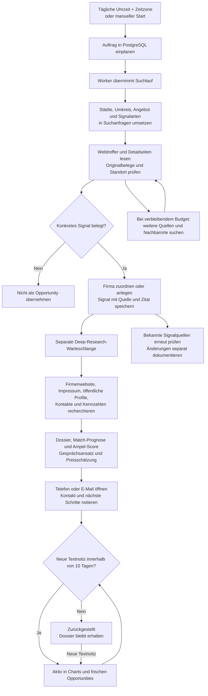

# Rechercheablauf und Lead-Lebenszyklus

## Vom Suchauftrag zum Kontakt

Die Firmenrecherche läuft erst nach einem belegten Bedarfssignal an. Sie kann fehlende Angaben offenlassen. Öffentlich veröffentlichte Informationen, eine KI-Einschätzung und dokumentierte eigene Kontakte sind im Dossier unterscheidbar.

## Zeitplan und Warteschlangen

- **Tageszeitplan:** `dailyAt`, `timezone` und `dailyEnabled` kommen aus den Frontend-Einstellungen. Standard ist 07:00 Uhr in `Europe/Berlin`.
- **Einplanung:** Der Worker prüft ungefähr minütlich, ob die Ortszeit erreicht wurde. `scheduled_date` speichert den lokalen Kalendertag. Ein eindeutiger Datenbankindex verhindert mehrere automatische Aufträge für denselben Tag.
- **Zeitumstellung:** Eine im Frühjahr übersprungene Uhrzeit wird zur nächsten gültigen Zeit nachgeholt. Die doppelte Stunde im Herbst löst keinen zweiten Tagesauftrag aus.
- **Neustart:** Ein noch fehlender Auftrag für heute wird nach der eingestellten Uhrzeit nachgeholt. Frühere Ausfalltage werden nicht wiederholt. Bereits eingeplante Aufträge bleiben in PostgreSQL.
- **Ausführung:** `POST /api/research` reiht ein und antwortet mit HTTP 202. Der Worker verarbeitet über `POST /api/research/process` einen Auftrag. Ein seit mindestens 20 Minuten nicht aktualisierter laufender Auftrag kann erneut aufgenommen werden; die Verarbeitung ist mit einer Datenbanksperre gegen parallele Suchläufe abgesichert.
- **Vertiefung und Monitoring:** Eine separate Schleife verarbeitet Firmenrecherche und fällige Signalprüfungen. Nach einer Verarbeitung wartet sie zwei Minuten. Eine große Warteschlange kann daher später fertig werden als der ursprüngliche Suchlauf.

Das Abschalten der automatischen Recherche beendet die tägliche Einplanung. Bereits eingeplante Aufträge und Firmenvertiefungen werden weiter verarbeitet. Die eingestellte Startzeit ist der Zeitpunkt der Einplanung; ein ausgelasteter Worker kann den Lauf später beginnen.

## Suchabdeckung und Grenzen

Pro gewählter Stadt werden je nach aktivierten Skills Anfragen zu IT-Aufbau, Modernisierung, Stellenanzeigen, Ausschreibungen, Dienstleistergesuchen, Presse und öffentlichen Social-Media-Aufrufen vorbereitet. KI-Planung ergänzt bis zu acht Suchanfragen. Nach etwa 70 Prozent des Seitenbudgets kann eine zweite Runde bis zu acht zusätzliche Anfragen für bisher wenig berücksichtigte Städte, Nachbarorte und Quellenarten planen.

Das Frontend-Feld **Originalseiten pro Suchlauf** entspricht `searchLimit`: Standard 60, Minimum 12, Maximum 150. Es begrenzt Abrufversuche in der agentischen Signalerkennung. Die Zahl erfolgreich gelesener Originalseiten kann kleiner sein. Es ist weder ein Firmenziel noch ein Limit für alle späteren Deep-Research-Aufrufe. Ein ungefähr 18-minütiges Zeitbudget begrenzt zusätzlich den Suchlauf; bereits gespeicherte Ergebnisse bleiben erhalten.

Der konfigurierte Umkreis von 0 bis 250 km gilt um jede der maximal drei Städte. Exakte Ortsnamen werden normalisiert abgeglichen. Weitere Orte werden über OpenStreetMap/Nominatim in Deutschland aufgelöst und anhand der Luftlinie zwischen Ortszentren geprüft. Bei nicht auflösbaren Orten wird keine Zugehörigkeit zum Umkreis behauptet.

### Fortschritt richtig lesen

| Feld in `research_runs` | Bedeutung |
|---|---|
| `status` | `queued`, `running`, `completed` oder `failed` |
| `stage` | Aktueller Arbeitsschritt oder Abschlussstatus |
| `searched` | Ausgeführte Suchanfragen einschließlich fehlgeschlagener Versuche |
| `discovered` | Unterschiedliche gefundene URLs, einschließlich nachverfolgter Detailseiten |
| `verified` | Erfolgreich gelesene Originalseiten der agentischen Suche |
| `imported` | Neu gespeicherte Bedarfssignale; darunter können weitere Signale bekannter Firmen sein |
| `rejected` | Ausgewertete Originalseiten ohne übernommenes Signal |
| `error` | Gesammelte Fehler und Einschränkungen, auch bei teilweise erfolgreichem Lauf |
| `scheduled_date` | Lokaler Kalendertag eines automatischen Auftrags; bei manuellen Aufträgen leer |
| `updated_at` | Zeitpunkt des letzten Fortschrittsupdates |

Ein abgeschlossener Suchlauf mit einzelnen Quellenfehlern kann verwertbare Ergebnisse enthalten. **Abgeschlossen** bedeutet nicht, dass alle Firmenvertiefungen bereits fertig sind. Eine höhere Abrufgrenze verbessert die mögliche Suchabdeckung, garantiert aber keine Mindestanzahl von Opportunities.

## Belege und Firmendossier

Ein Signal benötigt den Firmennamen, einen passenden Standort, die genaue Original-URL und ein wörtlich im gelesenen Quellentext vorhandenes Zitat. Veröffentlichungsdatum wird gespeichert, soweit bekannt; der Prüfzeitpunkt wird getrennt erfasst. Firmen werden anhand ihrer Identität zusammengeführt. Signale und Signalereignisse bleiben getrennt von der Firma gespeichert.

| Datenbereich | Speicherung und Darstellung |
|---|---|
| Firma | Name, Ort, belegte Website, Bedarfssignal, Recherchestatus und Erfassungszeitpunkt |
| Signal | Original-URL, Belegzitat, Kategorie/Priorität, Quelleneinordnung, Veröffentlichungs- und Prüfdatum |
| Unternehmensfakten | Aussage/Wert, Gruppe (`company`, `management`, `financial`, `technology`), Quelle, Zitat, bekannte Veröffentlichung und Prüfzeitpunkt |
| Kontakte | Tatsächlich veröffentlichter Geschäftskontakt, Kontaktart, Fundstelle und Prüfdatum; offizielle Profile als Links |
| Bewertung | Teilpunkte, Gesamt-Score, Begründung, Prognose zur Zusammenarbeit, Passung zum gespeicherten Angebot und Gesprächseinstieg |
| Preis und Betreuung | Geschätzte Netto-Stundensatzspanne auf Ausgangsbasis 100 €/h und Potenzial eines monatlichen Vertrags |
| Eigener Verlauf | Notiz, Telefonat oder E-Mail mit Text und Erfassungszeitpunkt |

Die KI sucht unter anderem nach Impressum, Anschrift, Geschäftsführung, Mitarbeitenden, Technologie und veröffentlichten Finanzkennzahlen. Finanzangaben sollen ein Berichtsjahr nennen; fehlende Bilanzdaten werden nicht geschätzt. Ein offizieller Social-Media-Link kann auffindbar sein, obwohl Inhalte des Profils nicht öffentlich lesbar sind. Eine vollständige Abdeckung aller Plattformen und Register ist nicht zugesichert.

Die Match-Prognose berücksichtigt das im Frontend gespeicherte Angebot. Die maximalen Teilpunkte sind IT-Bedarf 35, Passung 25, Aktualität 15, wirtschaftliches Potenzial 15 und Kontaktwege 10. Die Ampelgrenzen sind grün ab 80, gelb ab 60 und rot darunter. Nachgewiesener IT-Bedarf, vermuteter Bedarf und externe Vergabebereitschaft bleiben getrennte Angaben.

## Notizen und die Zehn-Tage-Regel

Die Frist beträgt exakt zehn Tage ab der letzten gespeicherten Aktivität mit **nicht leerem Text**. Vor der ersten Textnotiz beginnt sie mit der ursprünglichen Erfassung der Firma. Bei älteren Datensätzen ohne Erfassungsdatum dient das erste verfügbare Erkennungsdatum als Ersatz.

| Aktion | Verlängert die aktive Frist? |
|---|---|
| Neue Textnotiz speichern | Ja |
| Telefonat oder E-Mail mit Text dokumentieren | Ja |
| Telefon-/E-Mail-Link öffnen | Nein |
| Telefonat oder E-Mail ohne Text dokumentieren | Nein |
| Automatische Firmenrecherche oder Signalprüfung | Nein |
| Neues automatisch erkanntes Signal einer vorhandenen Firma | Nein |
| Score ändern | Nein |

Ab dem Ablaufzeitpunkt gilt `is_stale: true`, `chart_eligible: false`. Ruhende Firmen werden nach aktiven Firmen einsortiert und erscheinen im Bereich **Zurückgestellt**. Ihre Fakten, Belege und Historie werden behalten. Die Ampel verwendet weiter den fachlichen `score`. Der separate `ranking_score` beträgt für ruhende Leads 25 Prozent des Scores und wird gerundet; bei aktiven Leads entspricht er dem Score. Eine neue Textnotiz aktiviert den Lead wieder.

`GET /api/opportunities` liefert unter anderem `last_note_at`, `freshness_at`, `stale_at`, `is_stale`, `chart_eligible` und `ranking_score`, dazu Kennzahlen, Chartdaten und den letzten Suchlauf. Chartdaten berücksichtigen ausschließlich aktive Leads. Ohne gespeicherte Firmen wird eine echte leere Liste geliefert; bei einem Datenbankfehler eine Fehlermeldung. Es gibt keinen Demo-Fallback.

Die SMTP-Wiedervorlage ist unabhängig: Sie verwendet die konfigurierbare Wiedervorlagefrist und den letzten dokumentierten Verlaufseintrag. Die Zehn-Tage-Regel der Charts ist fest und verlangt Text.

## Betrieb prüfen

1. In **Einstellungen → KI & Quellen** den gewählten API-Key und einen passenden Modellnamen speichern.
2. **Websuche ohne KI testen** prüft Suchdienst und Originalseitenzugriff. Ein erfolgreicher Test sagt noch nichts über KI-Auswertung oder die resultierende Firmenzahl aus.
3. Einen manuellen Suchlauf starten und unter **Recherche** Warteschlange, Fortschritt und mögliche Quellenfehler beobachten. Ohne laufenden Worker bleibt ein Auftrag eingeplant.
4. Eine gefundene Firma öffnen. Erst das belegte Signal prüfen, danach die separat eintreffenden Firmenfakten und Kontaktquellen.
5. Eine Textnotiz speichern und den Verlauf sowie die aktive Frist kontrollieren.

Der vollständige Rechercheablauf benötigt einen funktionierenden KI-Zugang und erreichbare öffentliche Quellen. Ein Suchdiensttest ersetzt keinen solchen Lauf.
